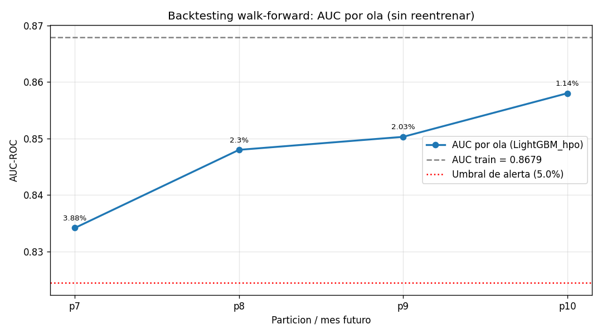
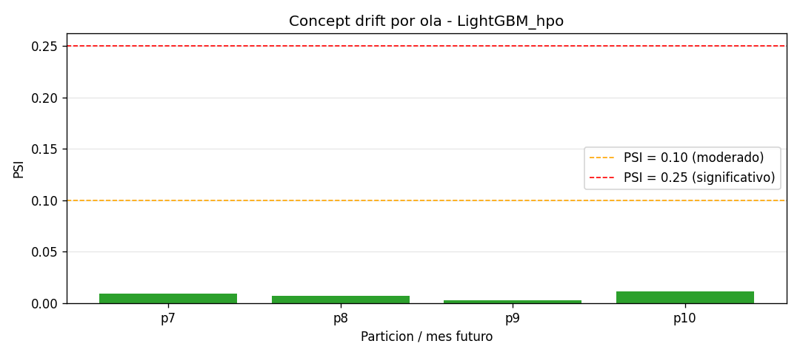
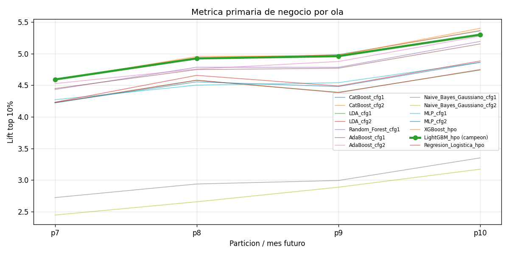
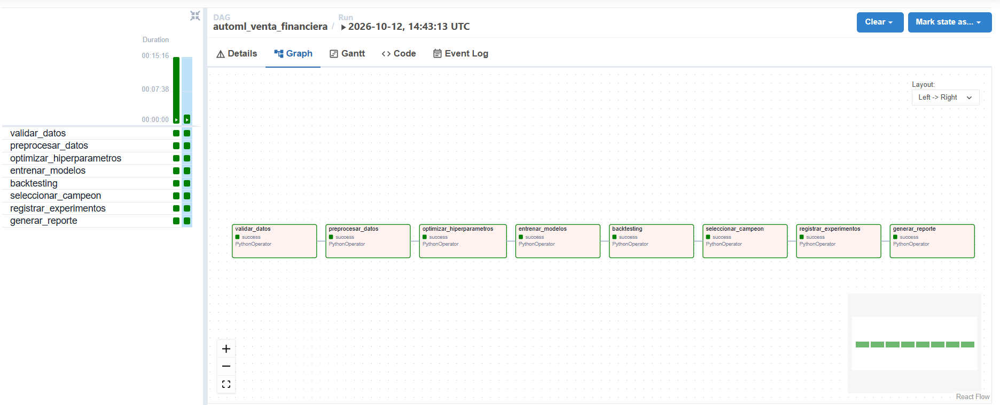
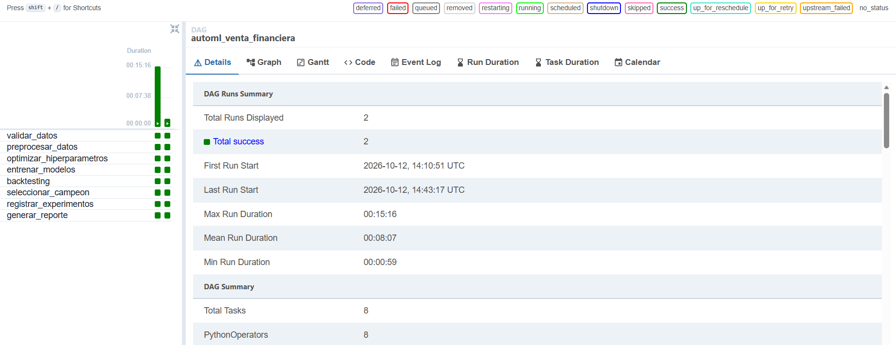
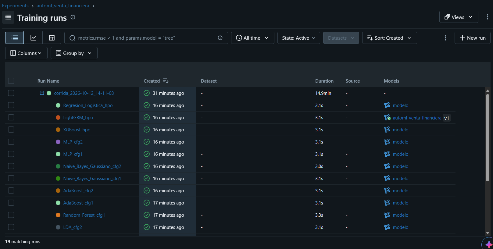
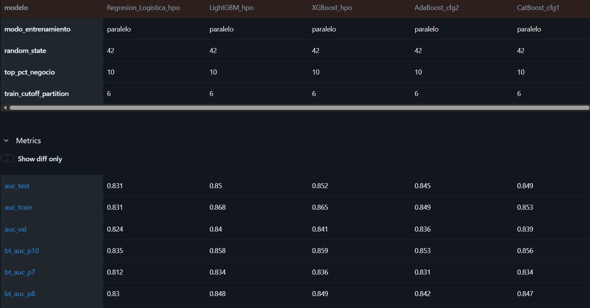
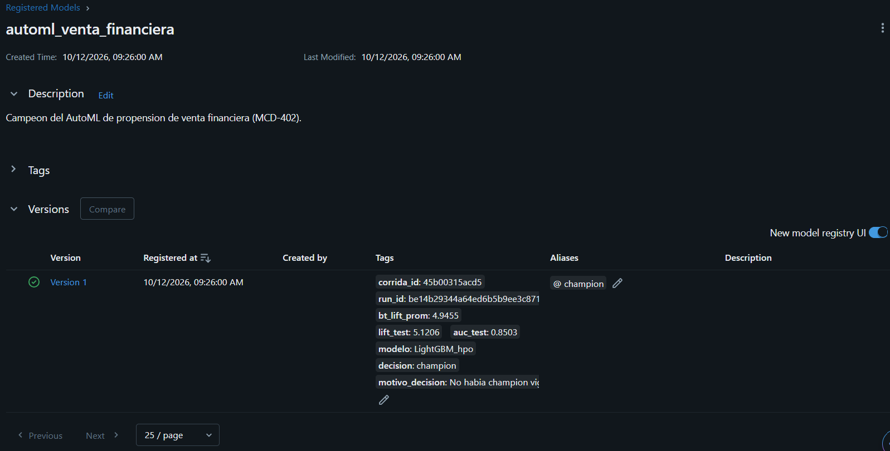

# AutoML — Propensión de Venta Financiera (Parcial: orquestación de pipelines)

**MCD-402 Machine Learning Operations · 2026-2**

Este repositorio continúa la Práctica 1 (AutoML) y la Práctica 2 (paralelismo, HPO y backtesting). En el parcial el AutoML pasa a ser un **pipeline de entrenamiento orquestado y reproducible**:

| Pieza nueva | Herramienta | Dónde está |
|---|---|---|
| Orquestación | Apache Airflow 2.10 (DAG manual, `schedule=None`) | `dags/training_dag.py` |
| Gestión de experimentos + Model Registry | MLflow 3.17 | `src/registry.py` |
| Contenerización | Docker + Docker Compose | `Dockerfile`, `docker-compose.yml` |
| Logs de cómputo (CPU, RAM, GPU, tiempos, tamaño) | psutil + pynvml | `src/monitoring.py` |
| HPO con librería de mercado | Optuna (TPE) | `src/hpo.py` |
| Métrica de negocio en `GetBestModel()` | Lift en el top 10 % | `src/evaluation.py` |
| Validación de datos (compuerta del DAG) | pandas | `src/validacion.py` |

Las decisiones de diseño (D1–D9) están justificadas en **[docs/decisiones_diseno.md](docs/decisiones_diseno.md)**.

> La versión entregada en la P2 está etiquetada como `v2.0-p2` (ver sección 12).

---

## 1. Cómo funciona (en una imagen)

```
                    docker compose up -d
 ┌──────────────────────────────────────────────────────────────────────┐
 │  airflow (http://localhost:8080)                                     │
 │                                                                      │
 │  validar_datos → preprocesar_datos → optimizar_hiperparametros →     │
 │  entrenar_modelos → backtesting → seleccionar_campeon →              │
 │  registrar_experimentos → generar_reporte                            │
 │        │                                   │                         │
 │        ▼                                   ▼                         │
 │  data/output/<fecha_hora>/  (JSON)    mlflow (http://localhost:5000) │
 │  data/intermedios/<corrida_id>/       runs, métricas, artefactos,    │
 │  (datos procesados y modelos)         modelos y Model Registry       │
 └──────────────────────────────────────────────────────────────────────┘
```

- Cada **tarea** del DAG llama a una función de `src/pipeline.py`. `python main.py` llama a **las mismas funciones** en el mismo orden, así que el DAG y la ejecución local hacen exactamente lo mismo.
- Entre tareas, por XCom, solo viaja la **ruta de la carpeta de la corrida** y su identificador. Los datos y los modelos van a disco o a MLflow.
- Una **corrida** se identifica por `corrida_id` = hash(configuración + datos + commit de git). Si se vuelve a lanzar el DAG sin cambiar nada, se reconoce la misma corrida y no se duplica nada (idempotencia, sección 8).

## 2. Requisitos

- **Docker Desktop** (en Windows, con WSL 2). Comprobar con `docker --version` y `docker compose version`.
- **RAM:** la tarea más pesada (preprocesar las 10 particiones) usa ~3 GB. Docker con WSL 2 usa por defecto hasta el 50 % de la RAM de la máquina; con 12 GB o más no hay que tocar nada (ver sección 13 si falta memoria).
- **Git**, para clonar el repositorio.
- **Python** solo si se quiere correr `python main.py` fuera de Docker (sección 6).

## 3. Cómo obtener el dataset

El dataset **no está en el repositorio**. Se descarga del Drive del curso:
<https://drive.google.com/drive/folders/1IKpzgvN9g9SxBO-dOGoWHmc_E-worDXU>

Se colocan los 10 CSV **directamente** en `data/input/`:

```
automl_venta_financiera/
└── data/
    └── input/
        ├── p1_extrac.csv
        ├── p2_extrac.csv
        ├── ...
        └── p10_extrac.csv
```

Docker monta la carpeta del proyecto dentro del contenedor (`/opt/proyecto`), así que el pipeline lee `data/input/` sin copiar nada. La primera tarea del DAG verifica que estén las 10 particiones (sección 10).

## 4. Ejecución con Docker (paso a paso)

Todos los comandos se ejecutan desde la carpeta del proyecto (`automl_venta_financiera/`).

### 4.1 Construir las imágenes y levantar los servicios

```bash
docker compose build        # la primera vez tarda ~10 min (descarga Airflow, MLflow y librerías)
docker compose up -d        # levanta postgres, mlflow, init-permisos y airflow
docker compose ps           # esperar a que mlflow y airflow digan "running" / "healthy"
```

| Servicio | Para qué | Dirección |
|---|---|---|
| `airflow` | interfaz web + scheduler | <http://localhost:8080> — usuario **admin**, contraseña **admin** |
| `mlflow` | gestor de experimentos | <http://localhost:5000> |
| `postgres` | base de datos interna de Airflow | (interno) |
| `init-permisos` | da permisos a los volúmenes y termina | (se ejecuta una vez) |

La interfaz de Airflow tarda 1–2 minutos en responder la primera vez.

### 4.2 Ejecutar el DAG

**Opción A, desde la interfaz:** abrir <http://localhost:8080>, buscar el DAG `automl_venta_financiera` y pulsar ▶ **Trigger DAG**. Para cambiar algo solo en esa ejecución, usar **Trigger DAG w/ config**, por ejemplo:

```json
{"paralelo": false}                 // entrenar en secuencial
{"n_jobs": 2}                       // 2 workers en paralelo
{"input_path": "data/muestra"}      // prueba rápida con una muestra (sección 5)
```

**Opción B, desde la terminal** (ejecuta todo el DAG y muestra los logs en pantalla):

```bash
docker compose exec airflow airflow dags test automl_venta_financiera
```

Con las 10 particiones completas el DAG tarda alrededor de 25–40 minutos, según la máquina. Al terminar:

- En MLflow (<http://localhost:5000>), experimento `automl_venta_financiera`, aparece un run **`corrida_<fecha_hora>`** con sus runs hijos: un run por modelo, uno por cada búsqueda de HPO y uno de validación de datos.
- En `data/output/<fecha_hora>/` quedan todos los JSON de la corrida (sección 7), incluido `tablas_readme.md` con las tablas de este README.

### 4.3 Apagar y volver a levantar

```bash
docker compose down         # apaga; los volúmenes (MLflow, Airflow, intermedios) se conservan
docker compose up -d        # vuelve a levantar todo, con los experimentos anteriores
docker compose down -v      # ¡cuidado! borra también los volúmenes (MLflow y Airflow desde cero)
```

### 4.4 Ver logs si algo falla

```bash
docker compose logs -f airflow
docker compose logs -f mlflow
```

## 5. Prueba rápida con una muestra (opcional)

Para comprobar que todo funciona antes de la corrida completa, se puede crear una muestra de 15 mil filas por partición en `data/muestra/` (está en `.gitignore`) y lanzar el DAG con `{"input_path": "data/muestra"}`. Tarda unos 5 minutos.

```bash
docker compose exec airflow python -c "import glob,os,pandas as pd; os.makedirs('data/muestra',exist_ok=True); [pd.read_csv(f,nrows=15000).to_csv('data/muestra/'+os.path.basename(f),index=False) for f in glob.glob('data/input/*.csv')]"
```

## 6. Ejecución local sin Docker (como en la P1/P2)

```bash
pip install -r requirements.txt
python main.py                          # usa config/config.yaml
python main.py --input data/input --config config/config.yaml
python main.py --sequential             # o --parallel, o --n-jobs 2
```

`main.py` ejecuta las mismas 8 tareas del DAG. Si `docker compose` está levantado, los runs van al mismo MLflow (<http://localhost:5000>); si no, se guardan en `mlflow_local.db` (respaldo local, `config.yaml → tracking.tracking_uri_respaldo`), que se puede ver con `mlflow ui --backend-store-uri sqlite:///mlflow_local.db`.

> Airflow no corre de forma nativa en Windows: para el DAG siempre se usa Docker.

## 7. Estructura del proyecto

```
automl_venta_financiera/
├── main.py                       ← ejecución local (mismas tareas que el DAG)
├── Dockerfile                    ← NUEVO: imagen de Airflow + librerías del AutoML
├── docker-compose.yml            ← NUEVO: postgres + mlflow + airflow
├── docker/mlflow/Dockerfile      ← NUEVO: imagen del servidor de MLflow
├── requirements.txt              ← librerías para main.py (local)
├── requirements-docker.txt       ← NUEVO: librerías dentro de Docker (versiones fijas)
├── config/
│   └── config.yaml               ← + entrenamiento, métrica de negocio, HPO, validación,
│                                   tracking (MLflow), monitoreo y airflow
├── dags/
│   └── training_dag.py           ← NUEVO: DAG de Airflow
├── src/
│   ├── pipeline.py               ← NUEVO: una función por tarea del DAG
│   ├── preprocessing.py          ← igual que P2 (+ optimización de memoria)
│   ├── validacion.py             ← NUEVO: compuerta de calidad de datos
│   ├── hpo.py                    ← Optuna (y RandomizedSearchCV de la P2 como línea base)
│   ├── models.py                 ← igual que P2
│   ├── parallelism.py            ← igual que P2 (+ modo "auto" y guardado por modelo)
│   ├── training.py               ← metadata extendida (métrica de negocio y cómputo)
│   ├── backtesting.py            ← igual que P2 (+ lift por ola)
│   ├── evaluation.py             ← GetBestModel() rediseñado + métricas de negocio
│   ├── registry.py               ← extendido: trazabilidad + MLflow + Model Registry
│   ├── monitoring.py             ← NUEVO: logs de cómputo
│   └── reporte.py                ← NUEVO: results_summary.json y tablas del README
├── scripts/
│   └── verificar_idempotencia.py ← NUEVO: evidencia de idempotencia
├── docs/
│   ├── decisiones_diseno.md      ← NUEVO: D1 a D9
│   └── img/                      ← NUEVO: capturas de Airflow y MLflow
├── tests/
│   └── test_metricas_negocio.py  ← NUEVO: pruebas del lift y de GetBestModel()
├── notebooks/
│   ├── validacion.ipynb          ← ejecuta el pipeline paso a paso (Colab o local)
│   └── backtesting_analysis.ipynb← gráficos de AUC, lift y PSI por ola
└── data/
    ├── input/                    ← dataset (en .gitignore)
    ├── intermedios/              ← datos procesados y modelos de cada corrida (en .gitignore)
    └── output/
        └── YYYY-MM-DD_HH-MM-SS/  ← una carpeta por corrida
            ├── corrida.json              (corrida_id, trazabilidad, ejecuciones del DAG)
            ├── config.yaml               (configuración efectiva de la corrida)
            ├── validacion_datos.json
            ├── preprocesamiento.json
            ├── hpo_results.json
            ├── <modelo>_metadata.json    (uno por modelo)
            ├── backtesting_results.json
            ├── seleccion.json            (criterio y motivo de GetBestModel)
            ├── model_registry.json
            ├── compute_logs.json         ← NUEVO
            ├── results_summary.json
            └── tablas_readme.md          (tablas listas para el README)
```

## 8. Qué se registra en MLflow

Experimento **`automl_venta_financiera`**. Cada corrida tiene un **run padre** (`corrida_<fecha_hora>`) y, colgando de él:

| Run hijo | Contenido |
|---|---|
| `<modelo>` (uno por modelo) | **Parámetros:** hiperparámetros finales (`hp_*`), familia, hardware, corte, filas de train, semilla, modo de entrenamiento. **Métricas:** `auc_train`, `auc_test`, `auc_val`, `decay_pct`, `lift_test`, `ks_test`, `pr_auc_test`, backtesting por ola (`bt_auc_p7`, `bt_lift_p7`, `bt_decay_p7`, `bt_psi_p7`, …) y promedios (`bt_*_prom`), `training_time_s` y logs de cómputo (`computo_*`). **Artefactos:** modelo serializado (`modelo/`), curva ROC (`graficos/`), `backtesting_results.json`, `compute_logs.json`, `<modelo>_metadata.json` y `config.yaml`. |
| `HPO_<modelo>` | librería, trials, mejores hiperparámetros, mejor AUC de cv, tiempo y la curva `trial_auc_cv` (un punto por trial). |
| `validacion_datos` | resultado de la compuerta de datos (sección 10). |

El run padre guarda la configuración completa como parámetros, el **criterio de selección aplicado** (tags `campeon`, `estado_seleccion`, `motivo_seleccion`), las métricas de cómputo de cada tarea del DAG (`tarea_<tarea>_duracion_s`, `_cpu_pct_*`, `_ram_mb_*`) y los artefactos `results_summary.json`, `compute_logs.json`, `seleccion.json`, `tablas_readme.md`, etc.

**Tags de trazabilidad en todos los runs** (Sección 5.2):

| Tag | Qué es |
|---|---|
| `git_commit`, `git_branch` | commit y rama del código (se leen de `.git`) |
| `data_hash` | SHA-256 combinado de los 10 CSV (el hash de cada archivo está en `corrida.json`) |
| `config_hash` | SHA-256 de la configuración efectiva; el `config.yaml` completo va como artefacto |
| `docker_image` | `automl-venta-financiera:3.0-parcial` (definido en `docker-compose.yml`) |
| `airflow_dag_run_id` | ejecución del DAG que generó el run |
| `corrida_id` | identificador de la corrida (hash de los tres primeros) |

### Model Registry (punto extra)

El campeón de cada corrida se registra como nueva versión del modelo **`automl_venta_financiera`**:

- Si no hay *champion*, la nueva versión recibe el alias **`champion`**.
- Si ya hay uno, el nuevo modelo (*challenger*) lo reemplaza solo si su **lift promedio en backtesting es al menos 2 % mayor** (`tracking.margen_promocion_pct`) **y** `GetBestModel()` lo marcó como estable (estado `OK`). Si no, queda con el alias **`challenger`**.
- Cada versión guarda los tags `corrida_id`, `run_id`, `bt_lift_prom`, `decision` y `motivo_decision`; la decisión también queda en `model_registry.json` y en el run padre.

## 9. Resultados de la corrida final

Corrida oficial **`45b00315acd5`** (`data/output/2026-10-12_14-11-08/`), ejecutada por el DAG de Airflow en Docker (`dag_run_id = manual__2026-10-12T14:10:48+00:00`, commit `fa114b5`, imagen `automl-venta-financiera:3.0-parcial`). Las tablas salen de `tablas_readme.md` de esa corrida y coinciden con las salidas de `notebooks/validacion.ipynb`.

### 9.1 Modelo campeón: `LightGBM_hpo`

| | |
|---|---|
| Estado de `GetBestModel()` | **OK** (estable, se promueve) |
| AUC train / test / decay | 0.8679 / 0.8503 / 2.02 % |
| Lift@10 % en test | **5.12** |
| Lift@10 % promedio en backtesting (p7–p10) | **4.95** |
| Decay promedio en backtesting | 2.34 % (umbral 5 %) |
| PSI máximo en backtesting | 0.0117 (sin drift) |
| Tiempo de entrenamiento | 17.49 s |
| Model Registry | Versión 1 → alias **`champion`** |

> **Motivo de la selección:** lift promedio en backtesting 4.9455 (mejor del grupo: 4.9796, CatBoost_cfg2). Los 14 modelos pasaron los filtros de sobreajuste (decay < 10 %) y de estabilidad (decay de backtesting < 5 %). Como LightGBM_hpo está a menos del 2 % del mejor lift, el desempate es por costo: entrena en 17.49 s frente a 58.32 s de CatBoost_cfg2 (3,3 veces más rápido).

**Lectura para el negocio.** La tasa base de compra es **3,2 %**. Si la campaña contacta solo al 10 % de clientes con mayor probabilidad según el modelo, la tasa de respuesta sube a **16,4 %** (lift ≈ 5) y se captura el **51 % de todas las ventas** contactando a una décima parte de la base. Eso reduce el costo por venta de la campaña (llamadas, correos, ejecutivos) unas cinco veces frente a contactar al azar. Ganarle a CatBoost por 0,03 de lift no compensa triplicar el tiempo de entrenamiento en un pipeline que se re-ejecuta periódicamente (D4, D8 y D9 en [docs/decisiones_diseno.md](docs/decisiones_diseno.md)).

### 9.2 Tabla de modelos (ordenada por lift en backtesting)

| Modelo | Familia | AUC train | AUC test | Decay % | Lift@10% test | KS test | Lift@10% backtest (prom) | Decay backtest prom % | Tiempo (s) | Campeón |
|---|---|---|---|---|---|---|---|---|---|---|
| CatBoost_cfg2 | base_arboles_ensamble | 0.8588 | 0.8499 | 1.03 | 5.1147 | 0.5473 | 4.9796 | 1.35 | 58.32 | No |
| XGBoost_hpo | base_arboles_ensamble | 0.8654 | 0.8517 | 1.58 | 5.1424 | 0.5484 | 4.9719 | 1.96 | 17.68 | No |
| CatBoost_cfg1 | base_arboles_ensamble | 0.8533 | 0.8486 | 0.55 | 5.1101 | 0.5446 | 4.9653 | 0.97 | 29.16 | No |
| 🏆 **LightGBM_hpo** | base_arboles_ensamble | 0.8679 | 0.8503 | 2.02 | 5.1206 | 0.5464 | 4.9455 | 2.34 | 17.49 | **Sí** |
| AdaBoost_cfg2 | arboles_ensamble | 0.8485 | 0.8453 | 0.37 | 4.9689 | 0.5390 | 4.8604 | 0.71 | 212.61 | No |
| Random_Forest_cfg1 | arboles_ensamble | 0.8683 | 0.8398 | 3.28 | 4.9557 | 0.5280 | 4.8000 | 3.79 | 120.89 | No |
| AdaBoost_cfg1 | arboles_ensamble | 0.8473 | 0.8435 | 0.45 | 4.9010 | 0.5348 | 4.7810 | 0.86 | 93.20 | No |
| Regresion_Logistica_hpo | lineal | 0.8313 | 0.8308 | 0.07 | 4.7796 | 0.5091 | 4.5661 | 0.58 | 1.38 | No |
| MLP_cfg1 | redes_neuronales | 0.8404 | 0.8334 | 0.83 | 4.7724 | 0.5191 | 4.5446 | 1.41 | 17.88 | No |
| MLP_cfg2 | redes_neuronales | 0.8652 | 0.8375 | 3.20 | 4.7908 | 0.5241 | 4.5309 | 3.87 | 21.38 | No |
| LDA_cfg2 | lineal | 0.8295 | 0.8282 | 0.15 | 4.7203 | 0.5066 | 4.4851 | 1.23 | 2.67 | No |
| LDA_cfg1 | lineal | 0.8294 | 0.8281 | 0.16 | 4.7170 | 0.5063 | 4.4829 | 1.24 | 5.26 | No |
| Naive_Bayes_Gaussiano_cfg1 | probabilistico | 0.7545 | 0.7523 | 0.29 | 2.9789 | 0.4136 | 2.9993 | 0.36 | 0.50 | No |
| Naive_Bayes_Gaussiano_cfg2 | probabilistico | 0.7292 | 0.7295 | -0.05 | 2.7256 | 0.3887 | 2.7881 | -0.00 | 0.42 | No |

Ningún modelo fue descartado por `GetBestModel()`. Los ensambles de árboles dominan (lift ≈ 4,8–5,0); lineales y MLP quedan cerca (≈ 4,5) y Naive Bayes muy por detrás (≈ 2,9) por su supuesto de independencia entre variables.

### 9.3 Backtesting del campeón (entrenado hasta p6, sin reentrenar)

| Ola | p_fecinformacion | AUC | Decay % | Lift@10% | KS | PR-AUC | PSI | N obs |
|---|---|---|---|---|---|---|---|---|
| p7 | 20220901 | 0.8342 | 3.88 | 4.5920 | 0.5175 | 0.1518 | 0.0094 | 244 666 |
| p8 | 20221001 | 0.8480 | 2.30 | 4.9259 | 0.5366 | 0.2684 | 0.0073 | 240 726 |
| p9 | 20221101 | 0.8503 | 2.03 | 4.9619 | 0.5520 | 0.1723 | 0.0028 | 263 753 |
| p10 | 20221201 | 0.8580 | 1.14 | 5.3024 | 0.5621 | 0.1532 | 0.0117 | 317 378 |

**Promedios:** AUC 0.8476 · lift 4.9455 · decay 2.34 % · alerta de drift: **No**. Todos los PSI están muy por debajo de 0.10 (sin cambio significativo en la población), y el desempeño no se degrada con el tiempo: el lift sube de 4,59 en p7 a 5,30 en p10.

Gráficos generados en `notebooks/backtesting_analysis.ipynb`:

| AUC por ola del campeón | PSI por ola |
|---|---|
|  |  |



### 9.4 Búsqueda de hiperparámetros (Optuna TPE, 15 trials, cv = 3, 100 000 filas)

| Modelo | Mejor AUC (cv) | Tiempo (s) | Mejores parámetros |
|---|---|---|---|
| XGBoost | 0.8455 | 95.40 | `n_estimators=400, max_depth=3, learning_rate=0.05, subsample=0.8` |
| LightGBM | 0.8428 | 150.90 | `n_estimators=300, num_leaves=15, learning_rate=0.03, subsample=1.0` |
| Regresion_Logistica | 0.8317 | 27.03 | `C=0.01` |

### 9.5 Paralelismo y logs de cómputo

Entrenamiento en paralelo con `joblib (loky)`: **4 workers** sobre 16 núcleos, 14 experimentos. Tiempo de pared **274.9 s** frente a 598.84 s de la suma de tiempos individuales → **aceleración ×2.18**, con 4 procesos distintos y hasta 4 experimentos simultáneos (`parallelism.json`). Máquina: 16 núcleos, 7.67 GB de RAM, modo `solo_cpu`.

| Tarea del DAG | Duración (s) | CPU % prom | CPU % máx | RAM MB máx |
|---|---|---|---|---|
| validar_datos | 63.09 | 65.33 | 101.1 | 1 039.6 |
| preprocesar_datos | 73.97 | 86.19 | 101.0 | 2 917.97 |
| optimizar_hiperparametros | 280.74 | 1 471.14 | 1 589.9 | 1 026.37 |
| entrenar_modelos | 275.91 | 271.69 | 688.6 | 4 003.07 |
| backtesting | 120.52 | 171.82 | 1 320.3 | 1 986.09 |
| seleccionar_campeon | 0.16 | 12.70 | 12.7 | 334.94 |
| registrar_experimentos | 50.53 | 11.94 | 95.2 | 424.79 |
| generar_reporte | 1.44 | 66.45 | 83.9 | 378.59 |
| **Total** | **≈ 866 s (14,4 min)** | | | |

*CPU %: 100 % = un núcleo completo (1 471 % ≈ 14,7 núcleos ocupados durante el HPO).*

<details>
<summary>Logs de cómputo por modelo</summary>

| Modelo | Duración (s) | CPU % prom | CPU % máx | RAM MB prom | RAM MB máx | Tamaño modelo (MB) |
|---|---|---|---|---|---|---|
| CatBoost_cfg1 | 29.19 | 99.51 | 100.9 | 348.12 | 368.16 | 0.125 |
| CatBoost_cfg2 | 58.34 | 99.93 | 105.5 | 350.67 | 375.05 | 0.439 |
| LDA_cfg1 | 5.29 | 163.70 | 371.2 | 1 042.07 | 1 251.98 | 0.005 |
| LDA_cfg2 | 2.70 | 92.63 | 100.1 | 1 120.53 | 1 372.61 | 0.030 |
| Random_Forest_cfg1 | 120.90 | 100.12 | 100.9 | 401.75 | 406.82 | 6.845 |
| AdaBoost_cfg1 | 93.22 | 100.11 | 101.8 | 528.22 | 534.70 | 0.064 |
| AdaBoost_cfg2 | 212.62 | 100.13 | 101.8 | 640.15 | 651.94 | 0.186 |
| Naive_Bayes_Gaussiano_cfg1 | 0.52 | 101.10 | 101.1 | 444.59 | 444.59 | 0.004 |
| Naive_Bayes_Gaussiano_cfg2 | 0.44 | 101.00 | 101.0 | 444.34 | 444.34 | 0.004 |
| MLP_cfg1 | 17.89 | 100.21 | 101.2 | 1 211.30 | 1 228.85 | 0.143 |
| MLP_cfg2 | 21.39 | 100.75 | 112.4 | 1 264.83 | 1 277.55 | 0.185 |
| XGBoost_hpo | 17.70 | 100.06 | 100.8 | 540.49 | 541.94 | 0.451 |
| LightGBM_hpo | 17.50 | 100.32 | 101.8 | 438.53 | 562.94 | 0.522 |
| Regresion_Logistica_hpo | 1.39 | 99.90 | 100.0 | 1 242.09 | 1 309.62 | 0.003 |

</details>

### 9.6 Capturas de Airflow y MLflow

| DAG en Airflow | Ejecuciones del DAG |
|---|---|
|  |  |

| Runs en MLflow | Comparación de modelos | Model Registry |
|---|---|---|
|  |  |  |

### 9.7 Pruebas unitarias de la métrica de negocio

`tests/test_metricas_negocio.py` verifica `metricas_negocio()`, `calcular_decay()` y `GetBestModel()` con datos sintéticos (no necesita el dataset, Docker ni MLflow):

```bash
pip install pytest numpy scikit-learn
python -m pytest tests -v
```

Resultado: **10 passed**.

| Prueba | Qué comprueba |
|---|---|
| `test_modelo_perfecto_tiene_lift_10` | modelo perfecto con tasa base 10 % → lift = 10, captura = 100 %, KS = 1, PR-AUC = 1 |
| `test_modelo_al_azar_tiene_lift_cercano_a_1` | probabilidades al azar → lift ≈ 1 |
| `test_modelo_al_reves_tiene_lift_0` | modelo invertido → el top 10 % no tiene ventas |
| `test_top_20_por_ciento` | con top 20 % el modelo perfecto da lift = 5 |
| `test_tasa_base_es_la_proporcion_de_compradores` | la tasa base es la proporción de compradores |
| `test_decay_relativo` | decay relativo (D1): 0.90 → 0.81 = 10 % |
| `test_gana_el_mayor_lift` | `GetBestModel()` elige el mayor lift |
| `test_modelo_sobreajustado_queda_fuera_aunque_tenga_mejor_lift` | un decay > 10 % descalifica aunque el lift sea mejor (D8) |
| `test_empate_de_lift_gana_el_mas_rapido` | a menos de 2 % del mejor lift gana el más rápido |
| `test_sin_modelos_estables_no_se_promueve` | si ninguno es estable en backtesting: estado `CON_ALERTA` y no se promueve |

## 10. Validación de datos (punto extra)

`validar_datos` es la primera tarea y funciona como compuerta del DAG. Verifica:

1. que estén las 10 particiones esperadas (`p1`–`p10`);
2. que todos los CSV tengan el mismo esquema y las columnas obligatorias (`partition`, `p_fecinformacion`, `target`);
3. que las columnas obligatorias no tengan nulos y que el % global de nulos no supere el 30 %;
4. que cada partición sea un único mes `YYYYMMDD` válido dentro de [20220301, 20221201];
5. que el `target` solo tenga 0 y 1.

Si algo falla, el DAG se detiene **sin reintentos** (`AirflowFailException`) con un mensaje que dice qué está mal, por ejemplo:

```
DATOS INVALIDOS, el DAG se detiene:
  - Particiones esperadas [...]; faltan ['p10'], sobran []
```

El resultado queda en `validacion_datos.json` y en el run `validacion_datos` de MLflow (tag `resultado_validacion`).

## 11. Idempotencia y reintentos

- **Reintentos:** `config.yaml → airflow.retries` (2) y `airflow.retry_delay_minutes` (1).
- **Re-ejecutar no duplica nada:** misma configuración + mismos datos + mismo commit dan el mismo `corrida_id`, así que se reutiliza la carpeta de la corrida, cada tarea salta el trabajo ya hecho y en MLflow se busca el run por tags antes de crearlo. El mecanismo completo está en D7 ([docs/decisiones_diseno.md](docs/decisiones_diseno.md#d7-mecanismo-de-idempotencia)).
- **Un reintento a mitad del entrenamiento** solo entrena los modelos que faltaban (cada modelo se guarda apenas termina).

**Cómo demostrarlo:**

```bash
docker compose exec airflow airflow dags test automl_venta_financiera   # 1.ª vez: entrena todo
docker compose exec airflow airflow dags test automl_venta_financiera   # 2.ª vez: segundos, no repite nada
docker compose exec airflow python scripts/verificar_idempotencia.py
```

**Evidencia** (salida de `verificar_idempotencia.py`, guardada en [docs/idempotencia.txt](docs/idempotencia.txt)):

```
Experimento MLflow: automl_venta_financiera (id 1)
Runs activos en total: 19

Corrida 45b00315acd5  (2026-10-12_14-11-08)
  Ejecuciones del DAG sobre esta corrida: 2
    - manual__2026-10-12T14:10:48+00:00  (2026-10-12 14:11:08)
    - manual__2026-10-12T14:43:13+00:00  (2026-10-12 14:43:32)
  Runs en MLflow: {'modelo': 14, 'hpo': 3, 'validacion_datos': 1, 'corrida': 1}  -> total 19
  Modelos con runs duplicados: ninguno
```

El DAG se ejecutó **2 veces** sobre la misma corrida (mismo commit, datos y configuración), pero en MLflow hay **un solo juego de runs**: 1 run padre, 1 de validación, 3 de HPO y 14 de modelos (19 en total), sin duplicados. La segunda ejecución reconoció el mismo `corrida_id`, reutilizó la carpeta y no reentrenó ni volvió a registrar nada.

## 12. Versionado con Git (punto extra)

Se trabaja sobre el mismo repositorio de la P2, con una rama por funcionalidad que se integra a `main` mediante merge o pull request:

| Rama | Contenido |
|---|---|
| `feature/docker` | Dockerfile, docker-compose.yml, imagen de MLflow |
| `feature/tracking` | MLflow, trazabilidad, Model Registry |
| `feature/airflow` | DAG, pipeline por tareas, idempotencia, validación de datos |
| `feature/compute-logs` | monitoring.py y compute_logs.json |
| `feature/docs` | README, decisiones de diseño, capturas |
| `docs/graficos-backtesting` (PR #1) | gráficos de AUC, lift y PSI por ola del backtesting |
| `docs/evidencias-validacion` (PR #2) | `validacion.ipynb` con las evidencias de la corrida oficial |
| `test/metricas-negocio` (PR #3) | pruebas unitarias de la métrica de negocio y de `GetBestModel()` |
| `docs/resultados-readme` | resultados de la corrida final en el README (sección 9) |

Tags de versión: `v2.0-p2` (entrega de la P2) y `v3.0-parcial` (esta entrega).

## 13. Problemas frecuentes

| Problema | Solución |
|---|---|
| La tarea `preprocesar_datos` muere sin error (`Killed` / código -9) | Falta RAM para Docker. Cerrar otros programas o crear `C:\Users\<usuario>\.wslconfig` con `[wsl2]` y `memory=8GB`, luego `wsl --shutdown` y reabrir Docker Desktop. También se puede bajar `parallelism.n_jobs_max`. |
| `port is already allocated` (8080 o 5000) | Otro programa usa ese puerto. Cerrarlo o cambiar el puerto de la izquierda en `docker-compose.yml` (ej. `"8081:8080"`). |
| El DAG no aparece en Airflow | Esperar 1–2 minutos y revisar `docker compose logs airflow` (errores de importación). |
| `DATOS INVALIDOS` | Revisar que los 10 CSV estén en `data/input/` con su nombre original. |
| La carpeta del proyecto está en OneDrive | Pausar la sincronización mientras corre el DAG (escribe muchos archivos). |
| Se quiere empezar de cero | `docker compose down -v` (borra MLflow y Airflow) y borrar `data/output/<corrida>` y `data/intermedios/`. |

## 14. Entrega

- Repositorio **privado** de la P2, con el colaborador **`manassesmauricio-cloud`** (GitHub → Settings → Collaborators).
- Decisiones de diseño: [docs/decisiones_diseno.md](docs/decisiones_diseno.md).
- Capturas de Airflow y MLflow: [docs/img/](docs/img/).
- Corrida completa: `data/output/<corrida final>/`.
